# Sentinel AI

**AI that watches every campus camera, spots a weapon, follows the person camera to camera, and calls 911 with facts it can see.**

Built for the **Meta AI Developer Hackathon 2026** on **Meta Muse Spark Open** (served on **Baseten**) and **Meta SAM 3.1** (Meta Model API), with **SignalWire** telephony and **ElevenLabs** voice.

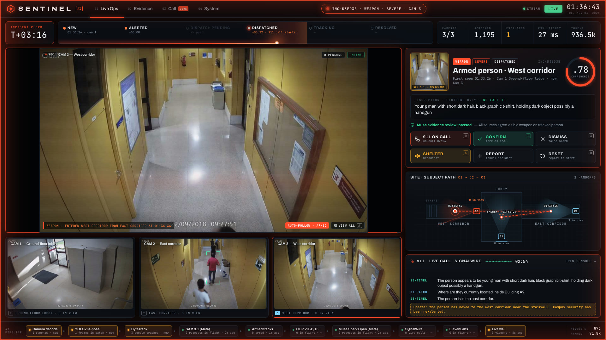

---

## Contents
1. [The problem](#the-problem)
2. [How it works in 60 seconds](#how-it-works-in-60-seconds)
3. [System architecture](#system-architecture)
4. [End-to-end incident flow](#end-to-end-incident-flow)
5. [Deep dive: every stage](#deep-dive-every-stage)
6. [Console tour](#console-tour)
7. [Performance and cost control](#performance-and-cost-control)
8. [Privacy and safety](#privacy-and-safety)
9. [Repository layout](#repository-layout)
10. [Configuration](#configuration)
11. [Run it](#run-it)
12. [Credits](#credits)

---

## The problem
Campuses have hundreds of cameras and a handful of officers. Almost every incident is on camera, and almost nobody sees it until it's over. The footage becomes evidence after the fact instead of help during it. When someone walks in with a gun, every second between the first frame and the first responder matters.

## How it works in 60 seconds
1. **Watch.** Three camera streams are decoded on one clock. **YOLO26s-pose** finds every person with 17 body keypoints; **ByteTrack** gives each one a stable ID.
2. **Screen cheaply.** Pose rules (falls, running, sudden acceleration, loitering) and a frozen **CLIP ViT-B/16** score every tracked person each second. A weighted fusion decides who is worth a closer look.
3. **Find the weapon.** For every tracked person, Sentinel enlarges a padded crop to 512 px and asks **Meta SAM 3.1** to segment a `gun`. CCTV weapons are only 10–25 px wide; at 512 px SAM 3.1 segments them with a confidence on every box.
4. **Understand.** An armed track escalates: 8 frames from the event window plus SAM's crop go to **Meta Muse Spark Open** on Baseten, which reasons over them and returns one label (`WEAPON | FIGHT | THEFT | RUN | MEDICAL | BENIGN`) with a confidence, then a clothing-only description.
5. **Verify.** A second, text-only Muse pass checks that classification, detector and description agree. Hard rules (one call per incident, hourly cap, kill switch) must also pass. If anything disagrees, the operator gets a one-click **Dispatch** instead.
6. **Call and follow.** Sentinel phones 911 over **SignalWire**, speaks with **ElevenLabs**, listens with on-device speech-to-text, answers the dispatcher from what the cameras show *right now*, and announces every camera handoff on the same call.

---

## System architecture

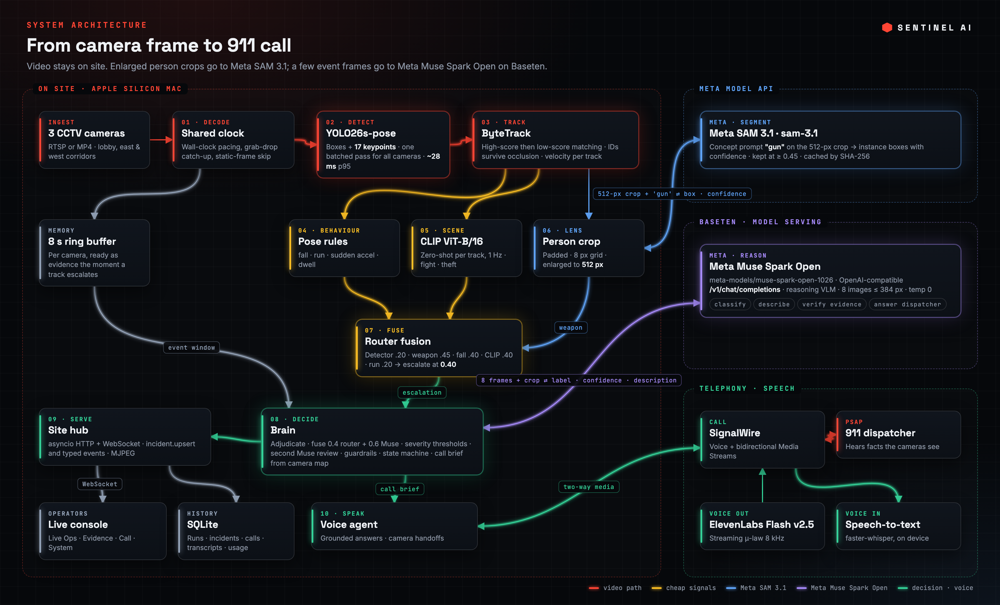

Everything that touches raw video runs on site. Only person crops (to SAM 3.1) and a handful of event frames (to Muse Spark Open) ever leave the building, and only text goes to the voice providers.

---

## End-to-end incident flow

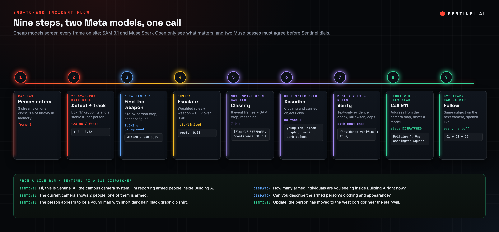

---

## Deep dive: every stage

### 1. Ingest and the shared clock
`services/vision/decode.py`, `services/vision/ring.py`

- Every camera is read by a frame source paced to the **wall clock**: if processing falls behind, the source grab-drops frames until it is back on time, so the console never shows stale video.
- Frames that are pixel-identical to the previous one (mean change under 0.1% of pixels at a 20-level threshold) skip the detector and reuse the last boxes, saving GPU time on static scenes.
- Each camera keeps an **8-second ring buffer** of frames. When something escalates, the evidence window is already in memory.

### 2. Person detection: Ultralytics YOLO26s-pose
`services/vision/detector.py`

- One **batched forward pass across all cameras** per step (Apple Silicon `mps`, CUDA or CPU).
- Output per person: box `(x, y, w, h)`, score, and **17 COCO keypoints** (nose, eyes, shoulders, elbows, wrists, hips, knees, ankles), each with a visibility confidence.
- Confidence threshold 0.50 (`CS_VISION_CONF`). p95 latency is about **28 ms per frame** on Apple Silicon, shown live on the System tab.

### 3. Tracking: ByteTrack
`services/vision/tracker.py`

ByteTrack's key idea is to **keep low-confidence detections instead of throwing them away**: a person who becomes partly hidden still produces a weak box, and matching that weak box to an existing track keeps the same ID through the occlusion.

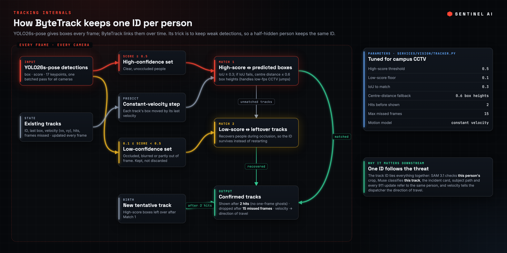

Each track carries its velocity `(vx, vy)` in pixels per step, which drives direction of travel and the behaviour rules.

### 4. Behaviour rules and CLIP
`services/vision/rules.py`, `services/vision/state.py`, `services/vision/vadclip.py`

Per-track rolling state (box, keypoints, torso angle, velocity over the last 1–2 s) feeds four rules:

| Rule | Fires when |
|---|---|
| `fall` | torso goes from upright (< 35°) to flat (> 55°) with a fast downward move (vy > 8 px/step) and the body stays 40 px lower |
| `run` | mean horizontal speed above 180 px/s |
| `sudden_acceleration` | frame-to-frame change in horizontal velocity above 14 px |
| `long_dwell` | less than 18 px of movement over 1.5 s |

A frozen **CLIP ViT-B/16** (OpenAI weights) scores each tracked person once per second, zero-shot. The person crop (20% padding) is compared against prompt ensembles: *"a person holding a gun"*, *"two people punching each other"*, *"someone shoplifting"* and others versus benign prompts (*"a person walking"*). The cosine gap between the best anomaly class and benign maps to a 0–1 score (a gap of 0.08 maps to 1.0, and under 0.02 there's no label), so CLIP can raise FIGHT or THEFT that posture alone would miss.

### 5. Fusion and escalation
`services/vision/fusion.py`, `services/api/vision_bridge.py`

Cheap signals are fused into one router score:

| Signal | Weight |
|---|---|
| Detector confidence | 0.20 |
| Weapon (SAM 3.1) | 0.45 |
| Fall | 0.40 |
| CLIP anomaly score | 0.40 |
| Run | 0.20 |
| Sudden acceleration | 0.10 |
| Long dwell | 0.10 |

A track escalates at **0.40**. Escalation is rate-limited (per-track cooldown, `CS_VISION_COOLDOWN_S`; at most `CS_VISION_MAX_UPSERTS_MIN` new Muse incidents per minute), so the expensive reasoning model only runs on what matters. The System tab's funnel shows the effect live: in the screenshot below, 1,255 frames were screened, 1 was escalated, and that 1 produced the incident and its call.

### 6. Weapon segmentation: Meta SAM 3.1
`services/vision/sam_weapons.py`

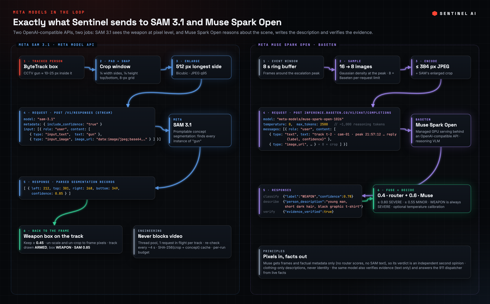

SAM 3.1 is Meta's promptable concept segmentation model: give it an image and a noun phrase and it returns every matching instance with a box and a confidence.

How Sentinel uses it:
1. **Crop.** Each tracked person's box is padded (¼ width each side, ⅛ height top and bottom) and snapped to an 8-pixel grid so identical footage yields identical crops.
2. **Enlarge.** The crop is scaled so its longest side is **512 px** (bicubic) and JPEG-encoded at quality 95. A 15-pixel handgun becomes a clearly resolved object.
3. **Prompt.** The crop is sent to the Meta Model API (`https://api.meta.ai/v1`, OpenAI-compatible Responses API, model `sam-3.1`) as `input_text: "gun"` plus `input_image` (data URL), with `include_confidence` metadata and streaming on.
4. **Parse.** The streamed result is parsed into segmentation box records `(left, top, right, bottom, confidence)`; boxes at or above **0.45** confidence are mapped back from crop to frame coordinates.
5. **Attach.** The highest-confidence box becomes the track's weapon. The track is drawn **ARMED** and its weapon box **WEAPON · SAM 0.85**, held on screen for 1.5 s and on the track for 4 s.

Engineering around it:
- **Never blocks video.** Each person is re-checked about every 4 s (`CS_SAM_CHECK_S`) on a background thread pool, with one request in flight per track.
- **Cached by content.** Results are keyed by SHA-256(crop JPEG + concept) and persisted, so replays of the same footage cost nothing.
- **Budgeted.** There's a per-run request cap (`CS_SAM_MAX_CALLS`) and a global paid-inference switch (`ALLOW_PAID_INFERENCE`).
- **Extensible.** `CS_SAM_CONCEPTS=gun,knife` adds more concepts with no code change.

### 7. Understanding: Meta Muse Spark Open on Baseten
`services/brain/muse_client.py`, `services/brain/sampler.py`, `services/brain/adjudicate.py`

Muse Spark Open (`meta-models/muse-spark-open-1026`) is Meta's open reasoning vision-language model. Baseten hosts it behind an **OpenAI-compatible Chat Completions endpoint** (`POST https://inference.baseten.co/v1/chat/completions`, `Authorization: Bearer $BASETEN_API_KEY`). Baseten runs the GPUs, autoscaling and batching; Sentinel just sends standard chat requests with images.

**What data goes to Baseten** (right half of the diagram above):

- **Frames, not opinions.** Muse sees pixels plus factual metadata (track ID, camera, peak timestamp) only. Router scores and SAM's text are deliberately left out, so its verdict is an independent second opinion.
- **Classification call.** Muse returns one JSON object, `{"label": "<WEAPON|FIGHT|THEFT|RUN|MEDICAL|BENIGN>", "confidence": 0.0-1.0}`, stored as a class token and log-confidence.
- **Description call.** A second request asks for `{"person_description": "..."}`: clothing and carried objects only, at most 20 words, never identity.
- **Reasoning budget.** Muse is a reasoning model and thinks with about 1,000 hidden tokens before answering, so requests allow 2,500 tokens. If the reasoning uses the whole budget, Sentinel retries once. Typical latency is 7–9 s per call.
- **Fusion.** Final probability = 0.40 × router score + 0.60 × Muse confidence. Optional temperature scaling (`CS_VLM_TEMPERATURE`) is fitted from labelled history (`scripts/fit_temperature.py`).
- **Severity.** At least 0.80 is SEVERE, at least 0.55 is MINOR (`bench/thresholds.json`); a WEAPON is always SEVERE.

### 8. Evidence review: the second Muse pass
`services/brain/track_ai.py`

Before any call, Muse receives the **text facts** of the incident (class, confidence, detector rules, SAM hit, description) under a strict verifier prompt and replies `{"evidence_verified": true|false, "reason": "..."}`. A call is placed only when **the local rules pass and the review explicitly says true**. Otherwise the incident stays ALERTED and the operator decides with one click.

### 9. Guardrails
`services/brain/guardrails.py`

- **Kill switch** (`CS_KILL_SWITCH=1`) blocks every call instantly.
- **One call per incident**, and a rolling **hourly cap** (`CS_DISPATCH_HOURLY_CAP`, default 6).
- Real calls only go to the single verified number in `SIGNALWIRE_TO_NUMBER`, never 911 directly.
- Drill scenarios (self-tests, training) run the same brain path but can never dial.

### 10. Incident state machine
`services/brain/state_machine.py`

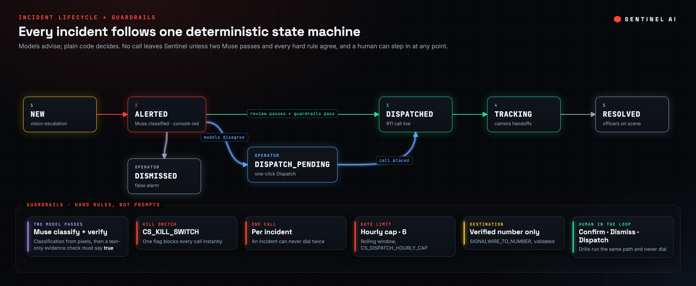

### 11. The call brief: facts, not guesses
`services/brain/call_brief.py`, `data/camera_map.json`

The address, building, entrances and coordinates come from the **camera map**, never from a model. The brief is assembled when the call starts and updated on every camera handoff, so the dispatcher always hears where the person is now.

### 12. Voice and telephony
`services/voice/`, `services/api/server.py`

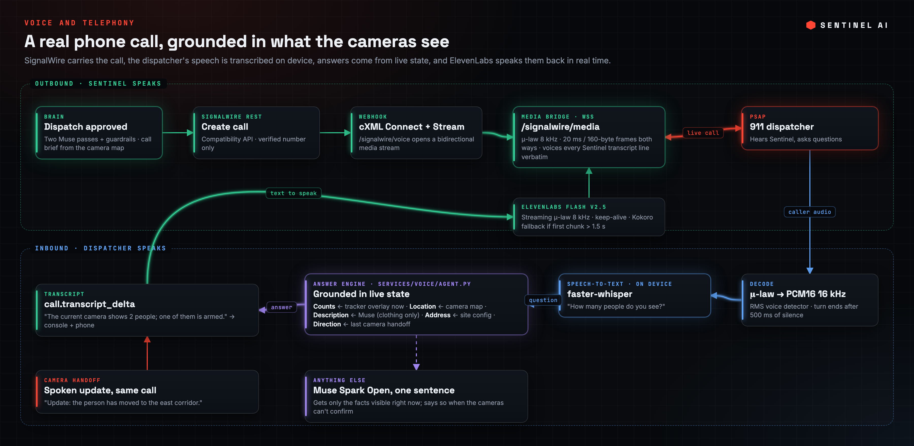

- **SignalWire.** An outbound call is created through the Compatibility REST API. When the call connects, SignalWire fetches cXML that opens a **bidirectional Media Stream** back to Sentinel (`/signalwire/media`).
- **Listening.** Inbound μ-law audio is decoded to PCM16 at 16 kHz, gated by an RMS voice detector, closed after 500 ms of silence, and transcribed by an on-device **faster-whisper** model (`scripts/serve_parakeet.py`, which accepts any Parakeet-compatible ASR backend).
- **Answering.** Common questions (address, counts, weapons, location, direction, injuries, description) come straight from live state: tracker counts, the camera map and Muse's description. Anything else goes to Muse with only the facts visible right now, and it must answer in one sentence or say the cameras can't confirm it.
- **Speaking.** **ElevenLabs Flash v2.5** streams μ-law 8 kHz audio over a keep-alive connection, sent back as 20 ms frames. If the first chunk doesn't arrive within 1.5 s, a local Kokoro voice fills in.
- **Following.** When the same subject appears on another camera, Sentinel interrupts with an update ("Update: the person has moved to the east corridor") on the same call.
- **No phone line?** Then Muse plays the dispatcher in an on-screen **AI-to-AI call** that uses exactly the same answering path.

### 13. API and real-time transport
`services/api/server.py`, `services/api/hub.py`, `contracts/`

A dependency-free **asyncio HTTP + WebSocket server** fans typed events out to every console.

| Route | Purpose |
|---|---|
| `GET /ws` | WebSocket: live event stream + commands (reset, pause, drill scenarios) |
| `GET /mjpeg/{cam}` | Annotated live video per camera |
| `GET /api/site`, `/api/mode`, `/api/track`, `/voice/status` | Site config, model IDs, model-review status, voice status |
| `POST /api/incidents/{id}/dispatch \| confirm \| dismiss` | Operator actions |
| `POST /api/incidents/manual`, `/api/broadcast` | Manual report, shelter-in-place broadcast |
| `POST /signalwire/voice`, `GET /signalwire/media` | Telephony webhook and media stream |

Events (`contracts/events.py`): `incident.upsert`, `incident.state_change`, `overlay.boxes`, `camera.online`, `health.strip`, `activity.tick`, `call.brief`, `call.transcript_delta`, `tool.call_live`, `usage.tick`, `control`. History (runs, incidents, calls, transcripts, model usage) is stored in SQLite.

---

## Console tour
The console is plain ES modules with no framework and no build step. It renders everything from the event stream.

**Live Ops, standby.** All three cameras are watched; every person is boxed with a track ID; the site map shows each camera's coverage.
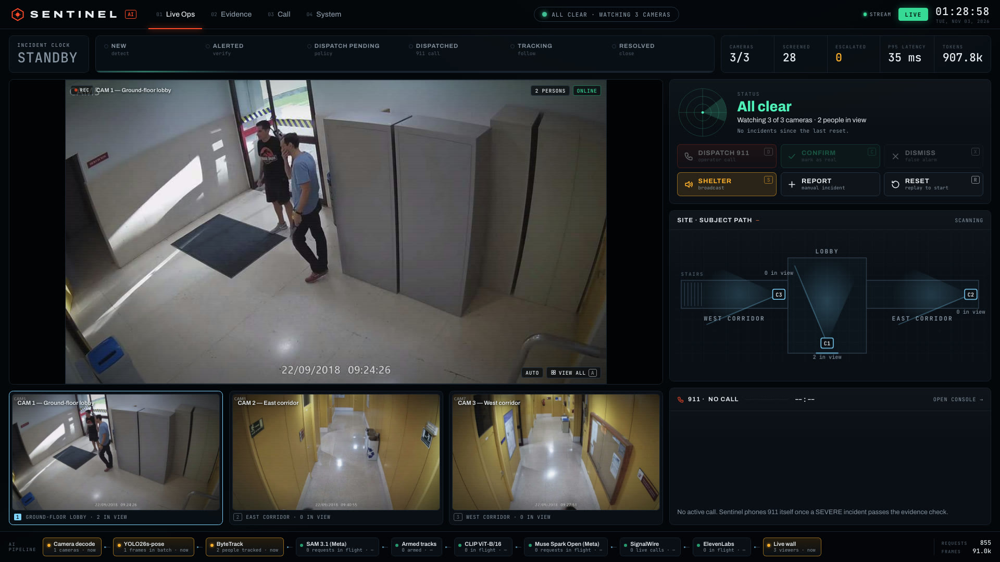

**Live Ops, incident.** The alert card shows class, severity and Muse confidence (.78), the clothing-only description, *Muse evidence review: passed*, the subject path across cameras, and the live 911 transcript.


**Evidence.** Why Sentinel acted: the live lens crop, Muse Spark Open's six-way classification, the second Muse check, and the decision chain DETECT → TRACK → SEGMENT → CLASSIFY → VERIFY → ACT with the state timeline.
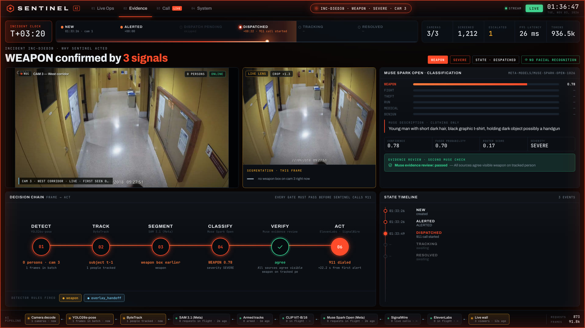

**Call.** The live 911 conversation with waveform, the camera the answers are grounded in, handoffs spoken to the dispatcher, and the call brief.
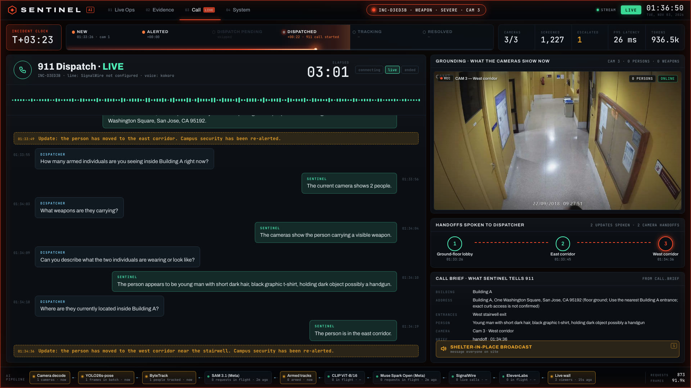

**System.** All 10 pipeline stages with live activity, p95 latency, the frames screened → escalated → incidents → calls funnel, and Muse token usage.
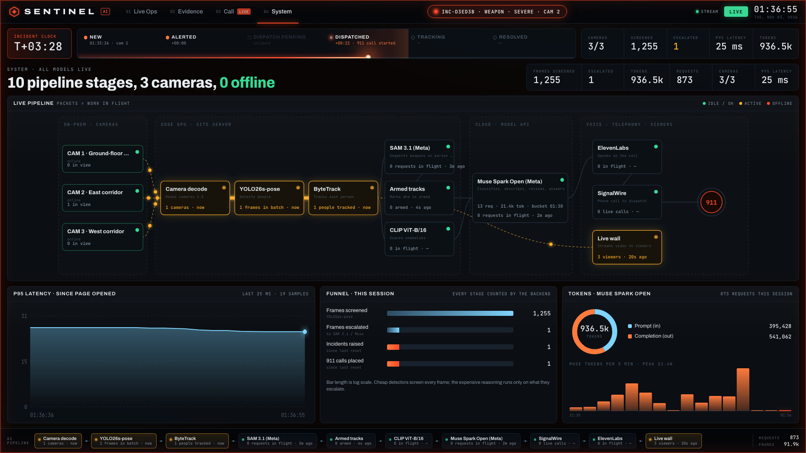

**Shelter-in-place.** A one-click broadcast to everyone, students, faculty and staff, or the security team.
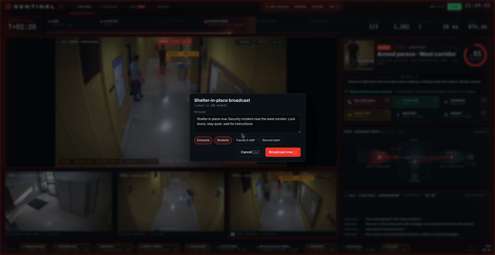

---

## Performance and cost control
| Stage | Where it runs | Typical latency |
|---|---|---|
| YOLO26s-pose + ByteTrack | On device (Apple Silicon) | ~28 ms per frame (p95) |
| CLIP ViT-B/16 | On device | once per track per second |
| Meta SAM 3.1 | Meta Model API | 1.5–2 s per crop, off the video path |
| Meta Muse Spark Open | Baseten | 7–9 s per call (reasoning) |

Cost stays proportional to risk, not to footage:
- The cheap stages screen every frame; the expensive ones only see what those stages escalate.
- SAM results are cached by content.
- Muse calls are rate-limited per minute and per track.
- Token usage is metered live on the System tab.

## Privacy and safety
- Video is processed on site. Only person crops (SAM 3.1) and up to 8 event frames per incident (Muse) are sent out; the voice providers receive text only.
- **No face recognition, no identity database.** Descriptions cover clothing and carried objects only, and the console marks this ("CLOTHING ONLY · NO FACE ID").
- Every automatic call requires two independent model passes plus the hard guardrails. A human can always dismiss, confirm or dispatch.
- The included footage is a staged mock attack.

## Repository layout
```
contracts/            typed events, incident and call-brief schemas
services/vision/      decode, ring buffer, YOLO26s-pose, ByteTrack, rules, CLIP, SAM 3.1, router
services/brain/       Muse client, sampler, adjudication, fusion, thresholds, review, guardrails, state machine
services/voice/       voice agent, SignalWire bridge, media stream, ElevenLabs, speech-to-text, tools
services/api/         asyncio HTTP/WebSocket server, site hub, vision bridge, history, telemetry
web/                  operator console (Live Ops, Evidence, Call, System)
data/                 camera map and camera feed definitions
scripts/              run script, speech servers, calibration tools
media/cctv_3cam/      three-camera CCTV footage
```

## Configuration
Copy `.env.example` to `.env`. The main settings:

| Variable | Purpose |
|---|---|
| `BASETEN_API_KEY` | Muse Spark Open on Baseten |
| `META_MODEL_API_KEY` | Meta SAM 3.1 (Meta Model API) |
| `ALLOW_PAID_INFERENCE`, `CS_SAM_MAX_CALLS`, `CS_SAM_CHECK_S`, `CS_SAM_CONCEPTS` | SAM budget, cadence and concepts |
| `CS_VISION_DEVICE`, `CS_VISION_CONF`, `CS_VISION_COOLDOWN_S`, `CS_VISION_MAX_UPSERTS_MIN` | Detector device/threshold and escalation rate limits |
| `CS_CALL_MODE` | `live` dials SignalWire; empty runs the on-screen AI-to-AI call |
| `SIGNALWIRE_*`, `CS_SIGNALWIRE_ENABLED`, `CS_PUBLIC_BASE` | Telephony credentials, enable flag, public URL for the media stream |
| `ELEVENLABS_API_KEY`, `CS_TTS_PROVIDER` | Voice |
| `CS_KILL_SWITCH`, `CS_DISPATCH_HOURLY_CAP` | Guardrails |

## Run it
macOS (Apple Silicon), Python 3.12:
```sh
uv sync
cp .env.example .env          # add BASETEN_API_KEY and META_MODEL_API_KEY
PYTHONPATH=. .venv/bin/python services/vision/pull_weights.py
make run                      # API on :8180, console on http://127.0.0.1:8190/
make check                    # self-checks, no paid calls
```

## Credits
Footage: US Mock Attack CCTV dataset (University of Seville), used with permission. J. L. Salazar González, C. Zaccaro, J. A. Álvarez-García, L. M. Soria-Morillo, F. Sancho Caparrini, "Real-time gun detection in CCTV: An open problem," *Neural Networks* 132 (2020) 297–308.
