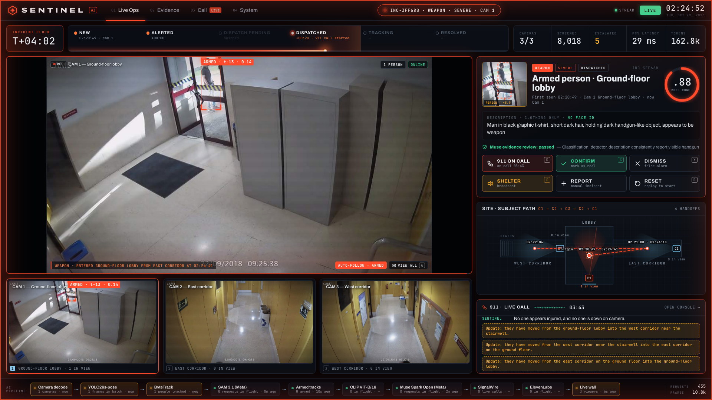
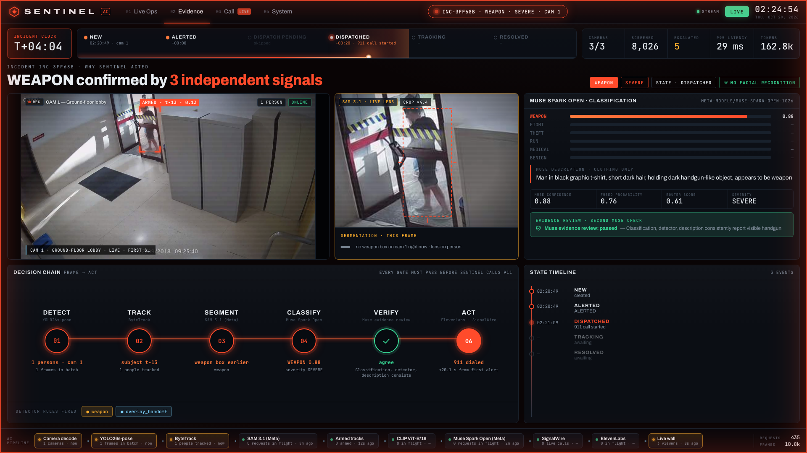
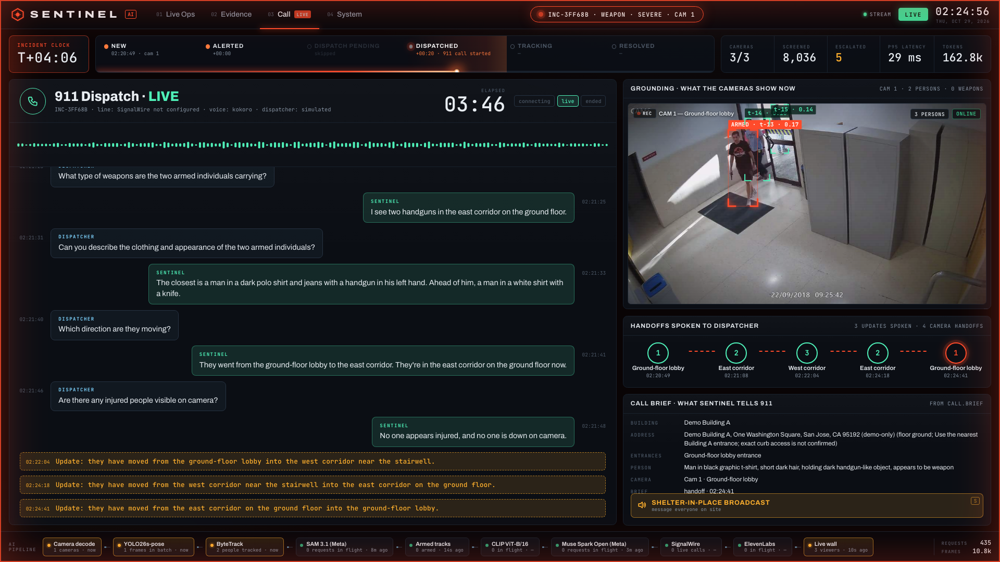
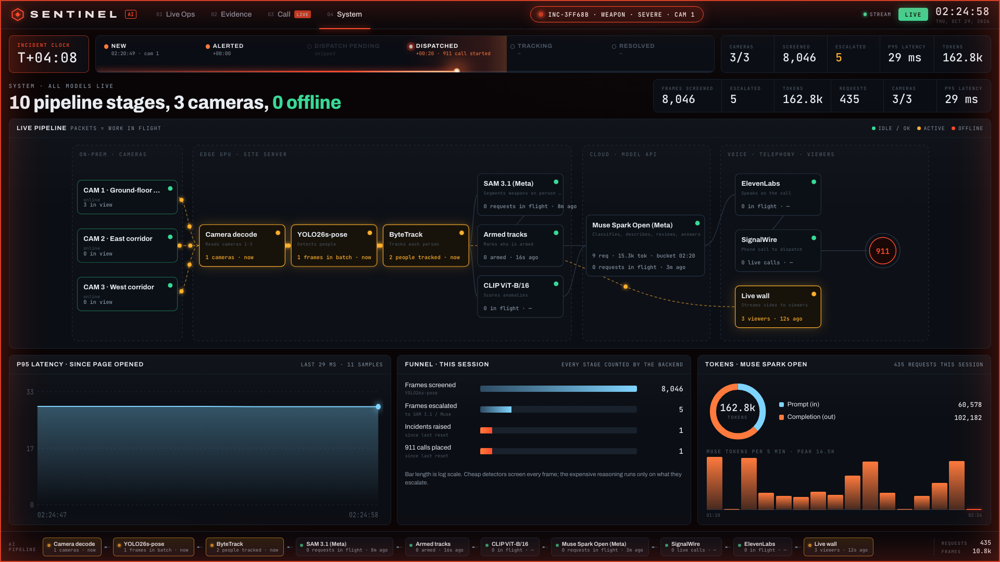

# Sentinel AI

**AI that watches every campus camera, spots a weapon, follows the person camera to camera, and briefs the 911 dispatcher with facts it can see.**

Built for the Meta AI Developer Hackathon (2026) on **Meta Muse Spark Open** (served on **Baseten**) and **Meta SAM 3.1**, with **SignalWire** and **ElevenLabs** for the call.



## The problem
Campuses have hundreds of cameras and a handful of officers. Almost every incident is on camera, and almost nobody sees it until it's over. The footage becomes evidence after the fact instead of help during it.

## What it does
1. **Watch.** Every camera, every frame: YOLO26s-pose finds each person and ByteTrack keeps an ID on them, locally on a Mac.
2. **Find the weapon.** Weapons in CCTV are 10–25 pixels, so full frames don't work (SAM 3.1 found 0 of 12). Sentinel crops and enlarges each tracked person and asks **Meta SAM 3.1** to segment a gun.
3. **Understand.** When someone is armed, **Muse Spark Open** looks at the clip plus SAM's enlarged crop and classifies it: `WEAPON | FIGHT | THEFT | RUN | MEDICAL | BENIGN`. It also describes the person by clothing.
4. **Check before acting.** A second Muse pass verifies that classification, detector and description agree. Hard rules decide: one call per incident, an hourly cap, a kill switch. If the models disagree, nothing is dialled and the operator gets one-click **Dispatch**.
5. **Call and follow.** Sentinel briefs the dispatcher, answers questions from what the cameras show at that second, and announces every camera handoff on the same call.

**Facts, not guesses.** The address comes from the camera map (`data/camera_map.json`), never from a model. Counts and weapons come from what the cameras show now. If it isn't visible, Sentinel says so.

## The pipeline
| Stage | What runs | Where |
|---|---|---|
| Decode | 3 camera streams on one logical clock | `services/vision/decode.py` |
| Detect | **Ultralytics YOLO26s-pose**: boxes + 17 COCO keypoints, one batched forward pass across cameras, conf 0.50 (p95 ≈ 28 ms per frame on Apple Silicon) | `services/vision/detector.py` |
| Track | **ByteTrack**: high-score boxes match first by IoU (≥ 0.3) to predicted boxes, then low-score boxes (0.1–0.5) recover occluded people; a track is shown only after several hits | `services/vision/tracker.py` |
| Rules + CLIP | Pose rules (fall, run, sudden acceleration, dwell) and a frozen **CLIP ViT-B/16** scoring each tracked person zero-shot for FIGHT / THEFT | `services/vision/rules.py`, `services/vision/vadclip.py` |
| Fuse | Weighted score (detector + rules + weapon + CLIP), escalate at 0.40. Cheap models screen every frame; reasoning runs only on what they escalate | `services/vision/fusion.py` |
| Segment | **Meta SAM 3.1** (`sam-3.1`, Meta Model API): padded person crop enlarged to 512 px, concept prompt `gun`, masks ≥ 0.45 confidence. Each person is re-checked every ~4 s on background threads, so video never stalls; results are cached by crop hash | `services/vision/sam_weapons.py` |
| Classify | **Meta Muse Spark Open** (`meta-models/muse-spark-open-1026`) on **Baseten**'s OpenAI-compatible API: multi-frame clip + SAM crop, temperature 0, one class token; its log-probability becomes the confidence | `services/brain/muse_client.py`, `services/brain/adjudicate.py` |
| Verify | Second Muse pass (text only) checks the evidence agrees before any call | `services/brain/track_ai.py` |
| Call | **SignalWire** voice with bidirectional Media Streams, **ElevenLabs Flash v2.5** streaming speech (μ-law 8 kHz), **Parakeet** speech-to-text; Muse answers the dispatcher from live facts. Without a phone line, Muse plays the dispatcher in an on-screen AI-to-AI call | `services/voice/` |

Measured on this build: SAM 3.1 1.5–2 s per crop with confidence on every box; Muse 7–9 s per call (a reasoning model, ~1,000 reasoning tokens per answer).

| Evidence | Call | System |
|---|---|---|
|  |  |  |

## Privacy
Video is processed on this computer. Only selected frames and person crops go to Meta models for analysis, and only text goes to the voice service. No face recognition, no identity database: Sentinel only describes clothing and what a person is carrying.

## Run it (macOS)
```sh
uv sync                                   # Python 3.12
cp .env.example .env                      # add BASETEN_API_KEY, META_MODEL_API_KEY
PYTHONPATH=. .venv/bin/python services/vision/pull_weights.py
make run                                  # API on :8180, console on http://127.0.0.1:8190/
```
Self-checks (no paid calls): `make check`.

To place real phone calls, set the `SIGNALWIRE_*` variables, `CS_SIGNALWIRE_ENABLED=1` and `CS_CALL_MODE=live`.

## Safety limits
One call per incident, an hourly cap and a kill switch. Real calls only ever go to the one verified number in `SIGNALWIRE_TO_NUMBER`, never 911. The included footage is a staged mock attack.

## Credits
Footage: US Mock Attack CCTV dataset (University of Seville), used with permission. J. L. Salazar González, C. Zaccaro, J. A. Álvarez-García, L. M. Soria-Morillo, F. Sancho Caparrini, "Real-time gun detection in CCTV: An open problem," *Neural Networks* 132 (2020) 297–308.
